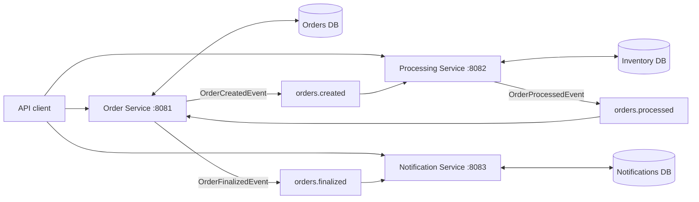
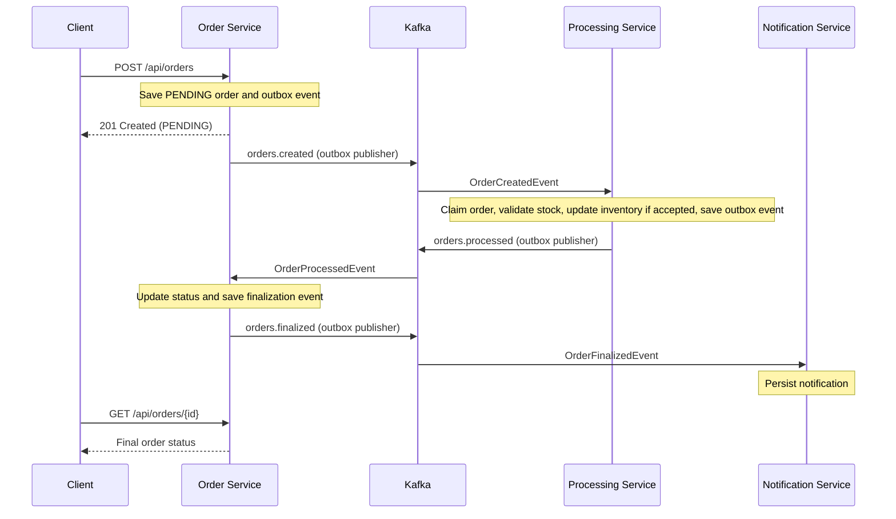
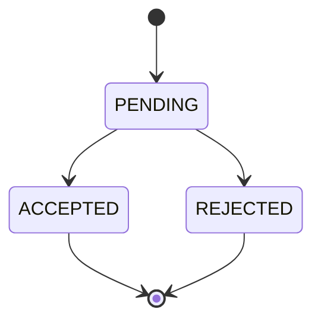

# Order Processing System

[](https://github.com/Lov3Life/order-processing-system/actions/workflows/ci.yml)

An event-driven backend system for asynchronous order processing, built with Java 21, Spring Boot, Apache Kafka and MySQL. The project demonstrates how independently running services can coordinate a business workflow while maintaining local transactional consistency and handling duplicate messages, concurrent inventory updates and messaging failures.

## Key features

- REST APIs for customers, orders, products, stock management and notification history.
- Asynchronous order processing through Kafka, with explicit order lifecycle transitions.
- Database-per-service design using three separate MySQL schemas.
- Transactional Outbox for reliable publication of business events.
- Idempotent consumers and pessimistic locking to prevent duplicate stock deductions and overselling.
- Shared consumer retry and dead-letter handling.
- Unit, integration and end-to-end tests with automated GitHub Actions CI.
- Docker Compose infrastructure with persistent storage and automatic database and topic initialization.

## Tech stack

| Technology | Purpose |
| --- | --- |
| Java 21, Spring Boot 4.1.2 | Application development |
| Spring MVC, Jakarta Validation | REST APIs and request validation |
| Spring Data JPA, Hibernate | Persistence and transactions |
| MySQL 8.4.13 | Relational storage |
| Apache Kafka 4.3.2, Spring Kafka | Event-driven communication |
| Maven | Multi-module build |
| JUnit 5, Mockito, MockMvc | Unit and controller testing |
| Testcontainers, Awaitility | Integration and asynchronous E2E testing |
| Docker Compose, GitHub Actions | Local infrastructure and CI |

## Architecture

The system consists of three Spring Boot applications. Each service owns its data and communicates with the others asynchronously through Kafka. REST APIs are exposed directly by the individual services; there is no API gateway.



The three topic nodes represent a single Kafka broker. The order and processing services publish their events through local outbox tables, rather than directly from their business transactions.

| Service | Port | Responsibility |
| --- | --- | --- |
| `order-service` | 8081 | Customer management, order creation and final status updates |
| `processing-service` | 8082 | Product management, inventory validation and atomic stock deduction |
| `notification-service` | 8083 | Persisting and exposing order outcome notifications |

### Order processing workflow



An order is created with the `PENDING` status. The processing service verifies every requested product and quantity before reducing any stock. If a product does not exist or available stock is insufficient, the entire order is rejected without changing inventory. The order service records the result before publishing the finalization event used by the notification service.



The final statuses cannot be changed through the normal workflow. Identical repeated status updates are treated as no-ops. Order acceptance represents successful inventory processing, not payment or shipment completion.

## Project structure

```text
order-processing-system/
├── order-service/          # Customers and orders
├── processing-service/     # Products and order processing
├── notification-service/   # Notification history
├── event-contracts/        # Shared Kafka event records
├── outbox-core/            # Shared outbox and Kafka error handling
├── e2e-tests/              # Cross-service workflow tests
├── database/               # SQL schemas and permission initialization
├── .github/workflows/      # CI workflow
├── .env.example
├── compose.yaml
└── pom.xml
```

`event-contracts` and `outbox-core` are shared libraries, not standalone services. The notification service uses the shared Kafka retry configuration without enabling the outbox publisher.

## Reliability and data consistency

### Transactional Outbox

Business changes and outgoing events are persisted in the same local database transaction:

| Operation | Business changes | Outgoing event |
| --- | --- | --- |
| Create order | Insert order and items | `OrderCreatedEvent` |
| Process order | Record processing result and update stock when accepted | `OrderProcessedEvent` |
| Finalize order | Update order status | `OrderFinalizedEvent` |

The outbox service requires an active transaction. A scheduled publisher polls up to 50 eligible `PENDING` events every two seconds by default, sends JSON messages to Kafka using the order ID as the key, waits for acknowledgment and marks successfully published records as `SENT`.

Failed publication attempts remain pending and are retried with increasing delay (10 seconds per attempt, capped at five minutes). The publisher does not currently enforce a terminal retry limit or automatically purge sent records.

A crash after Kafka acknowledges an event but before its outbox status is updated can result in duplicate publication. The design therefore targets **at-least-once delivery with idempotent business effects**, rather than end-to-end exactly-once delivery.

### Idempotency and concurrency

- **Processing service:** a unique order ID in `processed_orders` and an atomic database claim prevent repeated inventory deductions. The claim, stock changes, processing result and outbox event belong to the same transaction.
- **Order service:** a conditional database update changes the status only if it is still `PENDING`. A matching repeated result is ignored; conflicting final statuses are rejected.
- **Notification service:** existing notifications are checked by order ID. Matching notifications are ignored, conflicting results are rejected, and a database uniqueness constraint prevents duplicate notification records.
- **Inventory:** pessimistic write locks protect stock changes. Product IDs are sorted before locking to reduce the risk of deadlocks. All requested items are validated before any stock is deducted. Manual stock adjustments also use write locks.

### Retry and dead-letter topics

The shared Kafka error handler uses a fixed backoff of one second and allows two retries after the initial attempt for retryable failures. Unrecoverable messages are forwarded to their corresponding dead-letter topic (DLT); non-retryable failures may bypass retries.

Consumer offsets are not automatically committed, and the listener acknowledgment mode is `RECORD`. Dead-letter publication is checked for errors. Normal business rejections, such as insufficient stock, are successful message-processing outcomes and do not belong in a DLT.

DLTs retain problematic messages for diagnosis. Automated replay, alerting and recovery of orders affected by dead-lettered events are outside the current scope.

## Database architecture

Each service owns a separate schema on the local MySQL instance:

| Database | Tables |
| --- | --- |
| `order-processing-system-orders_db` | `customers`, `orders`, `order_items`, `outbox_events` |
| `order-processing-system-inventory_db` | `products`, `processed_orders`, `outbox_events` |
| `order-processing-system-notifications_db` | `notifications` |

Foreign keys are used within the order database. Product and order references across service boundaries are represented by IDs without cross-database foreign keys. Timestamps are handled in UTC. Hibernate validates the existing schema instead of generating it.

The SQL scripts in `database/` create the schemas, tables, indexes and constraints. Docker Compose also initializes permissions for the local application user. Initialization scripts run when MySQL starts with an empty data volume.

## Kafka topics

| Topic | Producer | Consumer | Event contract |
| --- | --- | --- | --- |
| `orders.created` | Order Service | Processing Service | `OrderCreatedEvent` |
| `orders.processed` | Processing Service | Order Service | `OrderProcessedEvent` |
| `orders.finalized` | Order Service | Notification Service | `OrderFinalizedEvent` |
| `orders.created-dlt` | Consumer error handler | — | Failed creation event |
| `orders.processed-dlt` | Consumer error handler | — | Failed processing result |
| `orders.finalized-dlt` | Consumer error handler | — | Failed finalization event |

Events are serialized as JSON and keyed by order ID. The local Compose configuration explicitly creates all six topics with one partition and a replication factor of one. Automatic topic creation is disabled.

Example `OrderCreatedEvent`:

```json
{
  "orderId": 1,
  "items": [
    { 
      "productId": 1, 
      "quantity": 3
    }
  ]
}
```

Example `OrderProcessedEvent`:

```json
{
  "orderId": 1,
  "status": "ACCEPTED",
  "reason": null
}
```

Example `OrderFinalizedEvent`:

```json
{
  "orderId": 1,
  "status": "ACCEPTED",
  "reason": null,
  "finalizedAt": "2026-11-27T12:00:00Z"
}
```

## Getting started

### Prerequisites

- JDK 21
- Maven 3.9+
- Docker with Docker Compose v2 (Docker Desktop or Docker Engine)
- Git

Ports `3306`, `9092`, `8081`, `8082` and `8083` must be available locally. No separate installation of MySQL or Kafka is required.

### 1. Clone the repository

```bash
git clone https://github.com/Lov3Life/order-processing-system.git
cd order-processing-system
```

### 2. Configure credentials

Copy `.env.example` to `.env`:

```bash
# Linux / macOS
cp .env.example .env
```

```powershell
# Windows PowerShell
Copy-Item .env.example .env
```

Example local configuration:

```dotenv
DBUSER=user
DBPASSWORD=password
MYSQL_ROOT_PASSWORD=local_root_password
```

Use local development credentials only. The `.env` file is ignored by Git. Docker Compose reads it automatically, but the locally running Spring Boot applications require `DBUSER` and `DBPASSWORD` in their environment as well.

### 3. Start the infrastructure

```bash
docker compose up -d
docker compose ps -a
docker compose logs kafka-init
```

Wait until MySQL and Kafka report `healthy` and the one-shot `kafka-init` service reports `Exited (0)`. Its logs should contain `Kafka topics initialized successfully.`

MySQL is available at `localhost:3306` and Kafka at `localhost:9092`. Both published ports are bound to the host loopback interface. Kafka and MySQL data are stored in named Docker volumes.

To inspect the Kafka topics:

```bash
docker compose exec kafka /opt/kafka/bin/kafka-topics.sh --bootstrap-server localhost:9092 --list
```

### 4. Build the applications

From the repository root:

```bash
mvn clean package -DskipTests
```

The build produces executable Spring Boot JARs with the `exec` classifier. To run the complete test suite instead, use `mvn clean verify`.

### 5. Start the microservices

Set the environment variables to the same values used in `.env` in each terminal, or configure them in your IDE run configurations.

```powershell
# Windows PowerShell (example credentials)
$env:DBUSER = "user"
$env:DBPASSWORD = "password"
```

```bash
# Linux / macOS (example credentials)
export DBUSER=user
export DBPASSWORD=password
```

Run the following commands in three separate terminals, from the repository root:

```bash
java -jar notification-service/target/notification-service-1.0-SNAPSHOT-exec.jar
```

```bash
java -jar processing-service/target/processing-service-1.0-SNAPSHOT-exec.jar
```

```bash
java -jar order-service/target/order-service-1.0-SNAPSHOT-exec.jar
```

Alternatively, run the three `*ServiceApplication` classes from your IDE. The services can start in any order once the infrastructure is ready.

### 6. Stop or reset the infrastructure

Stop the Java applications first, then run:

```bash
docker compose down
```

This preserves the named volumes. To reset the local environment completely:

```bash
docker compose down -v
```

**Warning:** the second command deletes all local database data, Kafka messages and consumer offsets stored in these volumes. Changing the `.env` credentials does not modify existing MySQL accounts in an initialized volume.

## REST API

### Order Service — `http://localhost:8081`

| Method | Endpoint | Description |
| --- | --- | --- |
| POST | `/api/customers` | Create a customer |
| GET | `/api/customers` | List customers |
| GET | `/api/customers/{id}` | Retrieve a customer |
| POST | `/api/orders` | Create a pending order |
| GET | `/api/orders` | List order summaries; optional `customerId` filter |
| GET | `/api/orders/{id}` | Retrieve an order with its items |

### Processing Service — `http://localhost:8082`

| Method | Endpoint | Description |
| --- | --- | --- |
| POST | `/api/products` | Create a product |
| GET | `/api/products` | List products |
| GET | `/api/products/{id}` | Retrieve a product |
| PATCH | `/api/products/addStockQuantity/{id}?quantity=5` | Increase stock |
| PATCH | `/api/products/subtractStockQuantity/{id}?quantity=5` | Decrease stock |

### Notification Service — `http://localhost:8083`

| Method | Endpoint | Description |
| --- | --- | --- |
| GET | `/api/notifications` | List notifications; optional `orderId` filter |
| GET | `/api/notifications/{id}` | Retrieve a notification by notification ID |

## Example workflow

The following requests use the HTTP file format supported by IntelliJ IDEA's HTTP Client. The same requests can be sent with Postman or another HTTP client.

### 1. Create a customer

```http
POST http://localhost:8081/api/customers
Content-Type: application/json

{
  "firstName": "John",
  "lastName": "Doe",
  "email": "john.doe@example.com"
}
```

### 2. Create a product

```http
POST http://localhost:8082/api/products
Content-Type: application/json

{
  "name": "Monitor",
  "stockQuantity": 10
}
```

### 3. Place an order

Use the IDs returned by the previous requests. The following example assumes both IDs are `1`.

```http
POST http://localhost:8081/api/orders
Content-Type: application/json

{
  "customerId": 1,
  "items": [
    {
      "productId": 1,
      "quantity": 3
    }
  ]
}
```

The API returns `201 Created` with an order in the `PENDING` state. Processing continues asynchronously.

### 4. Check the final result

Use the order ID returned in the previous response. Repeat the GET requests as needed until processing and notification creation complete.

```http
GET http://localhost:8081/api/orders/1
```

```http
GET http://localhost:8082/api/products/1
```

```http
GET http://localhost:8083/api/notifications?orderId=1
```

Expected results: the order status becomes `ACCEPTED`, product stock decreases from 10 to 7, and one notification is stored with the message `Order 1 has been accepted.`

To demonstrate rejection, submit another order requesting more than the remaining seven units. Its status becomes `REJECTED`, stock remains unchanged, and the notification includes a rejection reason.

## Testing

Run all tests from the root directory with Docker running:

```bash
mvn clean verify
```

The test suite uses its own temporary Kafka and MySQL containers. The Compose development infrastructure does not need to be running.

| Test level | Coverage |
| --- | --- |
| Unit | Business logic, validation, status transitions, outbox publishing and retry bookkeeping |
| Controller | REST endpoints, request validation and exception handling using MockMvc |
| Integration | Database persistence, transactions, rollback, Kafka publication and consumption, duplicates and concurrent processing |
| End-to-end | Full HTTP-to-Kafka workflow across all three Spring Boot applications |

The E2E module starts all three services in separate Spring application contexts on dynamically assigned HTTP ports, backed by real MySQL and Kafka Testcontainers. Awaitility is used to verify asynchronous outcomes, including:

- Accepted orders and correct stock deductions.
- Rejection for insufficient stock or missing products.
- Atomic handling of multi-item orders without partial deductions.
- Concurrent orders competing for the last available item.
- Final notification persistence and successful outbox publication.

The integration suite also checks duplicate events, simultaneous duplicate processing and rollback when outbox creation fails. Dedicated DLT and broker-outage recovery tests are not claimed as part of the verified coverage.

## Continuous integration

GitHub Actions runs on pushes and pull requests targeting `main`. The CI workflow uses JDK 21 and executes `mvn -B -ntp clean verify`, including the integration and E2E suites. E2E Failsafe reports are uploaded as workflow artifacts.

## Project scope and limitations

This is a portfolio and learning project focused on Kafka, distributed workflows and transactional consistency. It intentionally uses one instance of each service and one local Kafka broker. Docker Compose manages infrastructure only; Spring Boot applications run on the host.

The design does not provide API authentication or authorization, production-grade high availability, coordinated outbox publishing across multiple replicas, automated DLT replay, or payment and shipping workflows. Notifications are persisted and exposed through a REST API rather than delivered by email or SMS. A permanently failed consumer event can leave an order pending until an operator intervenes.

These boundaries keep the implementation focused on the core messaging and consistency problems rather than a complete e-commerce platform.
